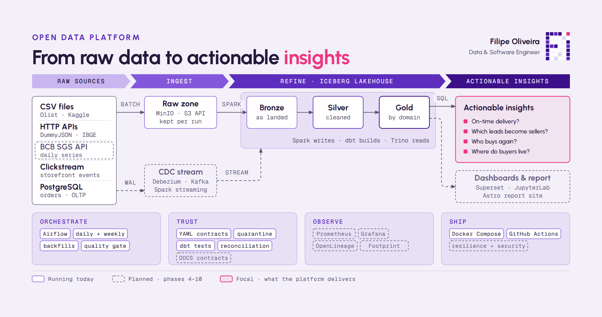

# Open Data Platform

<picture>
  <source media="(prefers-color-scheme: dark)" srcset="docs/assets/cover/cover-dark.png">
  
</picture>

A number in a report should have a path you can follow, from the source to the person who uses it.

- **Sources.** Historical files, HTTP APIs, a database window, and an event log share one raw layout.
- **Idempotency.** The same execution overwrites its own object.
- **Retention.** A new execution adds another object and leaves the previous one in place. Bronze and Silver replace the current table. They are not append-only.
- **Contracts.** Fields, keys, and invalid rows are defined before the load. Invalid rows stay in the file.
- **Modeling.** Gold is organized by business domain, with an explicit grain and keys.
- **Reconciliation.** A published figure is checked against the source it claims to represent.

Local work uses Windows 11, WSL2, and Docker Compose. Every component is open source and runs on the local stack.

---

## 📍 Status

| Field | Now |
| --- | --- |
| Current phase | Phase 4 — Streaming CDC. Not started; P11-04 (Spark on Kafka) comes first |
| Objective | Change capture from PostgreSQL through Debezium and Kafka, next to the daily and weekly batch |
| In place | Phases 0–3. Orchestration run on [2026-11-27](docs/architecture/phase-3-live-run.md) |
| Ledger | [`PROJECT_STATUS.md`](PROJECT_STATUS.md) · scope in [`ROADMAP.md`](ROADMAP.md) |

---

## ⚙️ Core features

| Feature | State | Phase | Core stack |
| --- | --- | --- | --- |
| Ingestion | Implemented | 1 | MinIO |
| Contracts | Implemented | 1 | YAML |
| Processing | Implemented | 2 | Spark · Iceberg · Trino · dbt |
| Orchestration | Implemented | 3 | Airflow |
| CDC | Proposed | 4 | Debezium · Kafka · Spark |
| Report site | Scaffold | 9 | Astro |
| Dataviz | Proposed | 8 | Jupyter · Superset |
| Lineage | Proposed | 5 | OpenLineage · dbt |
| Resource footprint | Proposed | 5 | — |

### ✅ Ingestion

- **Idempotency:** The same execution overwrites that object.
- **Retention:** A new execution keeps the previous file.
- **Metadata:** Each object records the source, the execution, and the ingestion time.
- **Source:** Olist e-commerce. Kaggle dataset. CC BY-NC-SA 4.0. Not stored in git. [Note](docs/sources/olist-brazilian-ecommerce.md)
- **Source:** Olist marketing funnel. Kaggle dataset. CC BY-NC-SA 4.0. Not stored in git. [Note](docs/sources/olist-marketing-funnel.md)
- **Source:** DummyJSON products. Paginated HTTP API. [Note](docs/sources/dummyjson-products.md)
- **Source:** IBGE municipalities. HTTP collection. [Note](docs/sources/ibge-localidades.md)
- **Source:** PostgreSQL orders. Windowed database extract. [Note](docs/sources/olist-synth-cdc.md)
- **Source:** Storefront clicks. Generated event log. [Note](docs/sources/demo-storefront.md)
- **Docs:** [Phase 1 ingestion](docs/architecture/phase-1-ingestion.md)

### ✅ Contracts

- **Schema:** Fields, keys, and null rules live in YAML.
- **Invalid rows:** Stay in the raw file.
- **Quarantine:** Findings go to a sidecar next to that file.
- **Rule:** The load does not drop invalid rows silently.
- **Docs:** [Data contracts](docs/architecture/data-contracts.md)

### ✅ Processing

- **Write path:** Spark writes Iceberg. Trino reads it.
- **Bronze:** Stores the payload and the ingestion metadata.
- **Silver:** Types columns, expands nested JSON, and deduplicates.
- **Gold:** Business-centric marts, one domain each.
  - Delivery and late orders
  - Reviews
  - Seller acquisition
  - Geography
  - Catalog
  - Storefront
  - Orders window
- **Reconciliation:** Compares the layers, and the published number with the source.
- **Commit:** Bronze merges new raw objects; Silver and Gold replace each table in one commit.
- **Docs:** [Lakehouse](docs/architecture/phase-2-lakehouse.md) · [Gold model](docs/architecture/gold-model-design.md) · [2026-11-11 run](docs/architecture/phase-2-live-run.md)

### 📋 Orchestration

- **Scheduler:** Airflow on the local Compose stack.
- **Daily batch:** One PostgreSQL window per day.
- **Weekly batch:** A distinct seven-day window.
- **Boundary:** Business logic stays in the package, not in the DAGs.
- **Backfill:** A window can be rerun without corrupting that window; a gap report lists missed windows.
- **Quality:** A failed Bronze or Silver check blocks the next layer; invalid records are quarantined and counted.
- **Docs:** [Phase 3 index](docs/architecture/phase-3-orchestration.md) · [Local Airflow](docs/architecture/airflow-local.md) · [2026-11-27 run](docs/architecture/phase-3-live-run.md) · [ADR-0006](docs/decisions/0006-orchestration.md) · [ADR-0007](docs/decisions/0007-daily-weekly-batch.md)

### 📋 CDC

- **Capture:** PostgreSQL logical replication.
- **Transport:** Debezium into Kafka.
- **Consumer:** Spark Structured Streaming.
- **Boundary:** Complements batch. Does not replace the daily or weekly windows.
- **History:** SCD Type 2 for the PostgreSQL entities, in the same phase.
- **Delivery:** Exactly-once is not claimed.
- **Docs:** [ADR-0008](docs/decisions/0008-streaming-cdc.md)

### 🚧 Report site

- **Pages:** Home, architecture, pipeline, operations, and reference.
- **Stack:** Astro Starlight with the author's brand theme (violet and pink, Urbanist); the header links to the [portfolio](https://filipeoliveira-hub.com.br).
- **Content:** Verified facts only.
- **Preview:** `cd site && npm ci && npm run dev`
- **Hosting:** Public hosting is Phase 9. The URL then goes on the repository About → Website field.
- **Docs:** [`site/README.md`](site/README.md)

### 📋 Dataviz

- **Exploration:** JupyterLab on the host.
- **Charts:** Superset in Compose.
- **Access:** Both read Gold through Trino.
- **Writes:** Neither tool writes tables.
- **Gate:** Stays proposed until one query and one chart run against Trino.
- **Docs:** [ADR-0017](docs/decisions/0017-dataviz.md)

### 📋 Lineage

- **Emitters:** OpenLineage, only where support is verified.
- **Gold:** dbt lineage for the analytical models.
- **Evidence:** Edges come from a real run.
- **Diagrams:** A drawn picture is not a substitute.
- **Docs:** [ADR-0010](docs/decisions/0010-lineage.md)

### 📋 Resource footprint

- **Measure:** CPU, memory, disk, and storage per service, and run time per layer, for one documented run.
- **Cost to run:** Machine cost from stated hardware and electricity assumptions, labeled an estimate.
- **Analysis:** Where time and resources go, and what grows with history.
- **Maintenance:** Iceberg snapshot expiration uses the retention named in the footprint document.
- **Stack:** No cost product is selected.
- **Docs:** [Phase 5](ROADMAP.md)

---

## ▶️ Run it

- Raw files belong in the bucket `odp-raw`
- Fetch steps are under [`docs/sources/`](docs/sources/)
- Unit tests do not need those files

```bash
make live-bronze
make live-silver
make live-gold
make dbt-test-reconciliation
```

- `make live-gold` builds Gold and its schema tests
- Reconciliation is the last command, on purpose
- Spark and Trino start with these targets
- Spark and dbt run in one runtime image (`docker/runtime`), shared with Airflow
- dbt is not installed on the host
- They are not part of `docker compose up`
- The first Spark target stores jars in `.local/spark-ivy`
- The recorded result is the [2026-11-11 live run](docs/architecture/phase-2-live-run.md)

<details>
<summary>Install on a fresh machine</summary>

- Windows 11 with WSL2 Ubuntu, or another Linux host
- [uv](https://docs.astral.sh/uv/) **0.13.1**
- Docker Desktop with WSL integration
- Docker Compose v2
- GNU Make, optional
- Node.js 22.22+, only for the report preview

`uv sync` installs CPython 3.12. Use `uv run`, not system `python3`.

**uv 0.13.1**

```bash
curl -LsSf https://astral.sh/uv/0.13.1/install.sh | sh
source "$HOME/.local/bin/env"
uv --version
```

- `uv --version` must print `uv 0.13.1`
- The installer adds `~/.local/bin` to `PATH` through `~/.bashrc`
- Open a new terminal if `uv` is missing
- If `curl` is missing: `sudo apt update && sudo apt install -y curl ca-certificates`

**GNU Make (optional)**

```bash
sudo apt update && sudo apt install -y make
```

**Docker Desktop**

1. Install [Docker Desktop for Windows](https://docs.docker.com/desktop/setup/install/windows-install/) and leave it running. The engine stops when the app quits.
2. Open **Settings → Resources → WSL integration**. Enable Ubuntu, then **Apply & restart**.
3. In Ubuntu, `docker version` and `docker compose version` must both answer.

</details>

<details>
<summary>Check the local services</summary>

```bash
uv sync
cp .env.example .env
uv run ruff check src tests
uv run pytest tests/unit
docker compose up -d
docker compose exec postgres pg_isready -U odp -d odp
set -a && source .env.example && set +a
uv run pytest tests/integration/infrastructure/test_minio_smoke.py
```

- `cp .env.example .env` is optional
- Do not commit `.env`
- Compose starts PostgreSQL 16 and MinIO
- The MinIO image is a community build
  - Upstream stopped publishing official images
  - The server remains AGPLv3
- Pins are in the [lakehouse note](docs/architecture/phase-2-lakehouse.md)
- `make lint`, `make test`, `make up`, and `make test-minio` wrap the same commands

Stop and keep volumes:

```bash
docker compose --profile lakehouse stop
docker compose down
```

GitHub Actions runs the lint and unit tests on Python 3.12.

- It does not start Compose
- It does not deploy cloud resources

</details>

---

Contributors and agents follow [`AGENTS.md`](AGENTS.md).
