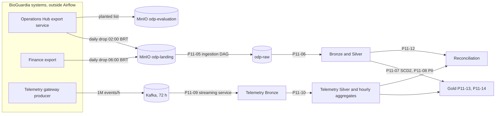

# BioGuardia Atlantic: domain and synthetic sources

| Document | Reference |
| --- | --- |
| Owns | The BioGuardia Atlantic domain model, its three synthetic sources, and how the Phase 11 issues use them |
| Decisions | [ADR-0027](../decisions/0027-bioguardia-synthetic-sources.md) (sources), [ADR-0028](../decisions/0028-telemetry-message-broker.md) (broker) |
| Source notes | [`bioguardia-ops-export.md`](../sources/bioguardia-ops-export.md), [`bioguardia-finance-export.md`](../sources/bioguardia-finance-export.md) (P11-02), [`bioguardia-telemetry.md`](../sources/bioguardia-telemetry.md) (P11-03) |
| Issues | Phase 11 in [`ROADMAP.md`](../../ROADMAP.md) (P11-01 to P11-18) |
| Status | Design (P11-01). The generators are P11-02 and P11-03; processing starts at P11-04 |

BioGuardia Atlantic is a fictitious public agency. It monitors protected reserves in the Atlantic Forest (Mata Atlântica) of Brazil, and its systems produce two big feeds for this platform: a daily batch export of operational data and a continuous telemetry stream. Every value is generated by this repository. Only the IBGE municipality codes are real public reference codes.

The volumes in this document are the design targets at scale 1. P11-02 and P11-03 measure them and record the result in the source notes and in [`docs/status-log.md`](../status-log.md).

## Organization

- About 120 protected reserves (parks, biological reserves, ecological stations, private reserves) in eight states: BA, ES, MG, RJ, SP, PR, SC, RS. Each reserve sits in one of 54 real municipalities (IBGE codes checked on 2026-11-26).
- About 6,000 monitoring zones (reserve sectors with a type: core, buffer, restoration, riparian, sustainable use).
- About 33,300 field devices: smoke and heat sensors, weather stations, river gauges, soil moisture probes, acoustic recorders, and camera traps.
- About 6,000 staff (rangers, biologists, technicians, pilots, lab analysts, reserve managers) and about 150,000 registered citizen reporters.
- 2,500 species in its reference list, with generated scientific and common names. No real taxon or IUCN assessment is used.

## Use cases and the data that serves them

| Use case | Latency | Batch tables | Stream topics | Gold issue |
| --- | --- | --- | --- | --- |
| Early wildfire and illegal deforestation detection | Minutes | `fire_hotspots`, `deforestation_alerts`, `incidents`, `citizen_reports`, `acoustic_detections` (chainsaw, gunshot) | `readings` (smoke, heat, weather), `alerts` | P11-13 |
| Wildlife biodiversity and acoustic monitoring | Daily, weekly | `acoustic_recordings`, `acoustic_detections`, `camera_trap_images`, `species` | `alerts` (human presence) | P11-14 |
| Watershed flood and drought | Hourly | `zones`, `devices` | `readings` (river gauges, soil moisture, rain) | P11-13 |
| Reforestation and carbon | Monthly, seasonal | `planting_lots`, `soil_lab_results`, `canopy_surveys`, `species` | — | P11-14 |
| Field operations and enforcement | Daily | `patrols`, `patrol_track_points`, `incidents`, `infraction_notices`, `fine_payments`, `staff` | — | P11-14 |

Binary media (audio files, camera-trap images, satellite rasters, LiDAR point clouds) are represented by their metadata and derived products. Generating the binaries is a candidate in the roadmap, not an issue: it adds storage without exercising the four cases below.

## Sources

| Source id | System | Delivery | Volume at scale 1 |
| --- | --- | --- | --- |
| `bioguardia_ops` | Operations Hub | Daily file drop in MinIO bucket `odp-landing`, released 02:00 BRT for the previous local day | About 23.8M rows per day: 357 MB of gzip files (3.2 GB uncompressed), measured; 2 GB of gzip per drop is the hard cap |
| `bioguardia_finance` | Finance system | Daily file drop in `odp-landing`, released 06:00 BRT | About 250 rows per day |
| `bioguardia_telemetry` | Telemetry gateway | Kafka, four topics | About 1.03M events per hour modeled (about 25M per day) |

All three run outside Airflow, as Compose services on their own profiles. When Airflow is down, drops keep accumulating in `odp-landing` and events keep accumulating in Kafka (72-hour retention), and the platform catches up when it returns.

## Daily export

### Layout

```text
odp-landing/
  bioguardia_ops/export_date=2026-11-26/export_version=1/
    _manifest.json
    reserves.csv.gz
    …
    camera_trap_images.jsonl.gz
    _SUCCESS
  bioguardia_finance/export_date=2026-11-26/export_version=1/
    _manifest.json
    fine_payments.csv.gz
    _SUCCESS
```

- `export_date` is the local business day of the agency, `[D 00:00-03:00, D+1 00:00-03:00)`. Brazil has had no daylight saving time since 2019, so local time is a fixed `-03:00` offset. Every timestamp in the files carries that offset explicitly.
- The ops drop for D is released at D+1 02:00 BRT; the finance drop at D+1 06:00 BRT. `_SUCCESS` is written last. A drop without it is incomplete.
- `_manifest.json` lists every table in the drop: file name, format, row count, bytes, SHA-256, schema version, columns and types, and control totals (exact decimal sums of the money and measure columns, and the timestamp range). The manifest says which tables a drop holds, so a table that is absent by design (`canopy_surveys` outside the first day of a month) is not an error.
- On scheduled dates a version 2 of date D is released three days after version 1 in `export_version=2/`. It is a full re-delivery of every table of D, with about 1% of `incidents` and `fire_hotspots` rows and 0.1% of `acoustic_detections` rows corrected, and any planted file defect of version 1 fixed. Versions 1 and 2 differ by design.
- CSV is RFC 4180, UTF-8, with a header row and quoted multi-line notes. Two tables with nested fields are JSON Lines. Everything is gzip.

### Table catalog

The ops drop holds 22 tables: 21 on a normal day, 22 on the first day of a month. The finance drop holds 1. Together: 23 datasets. Full column lists are in the source notes.

| Table | Change type | Key | Rows per day | Cases |
| --- | --- | --- | --- | --- |
| `reserves` | Snapshot | `reserve_id` | 120 | SCD2 (manager, management plan status, area revision); skew (one reserve holds about 30% of devices) |
| `zones` | Snapshot | `zone_id` | 6,000 | SCD2 (fire-risk class recomputed on the first day of each month) |
| `staff` | Snapshot | `staff_id` | 6,000 | PII (name, CPF, email, phone, birth date, home municipality); SCD2 (team, reserve, role, with some changes dated in the future) |
| `devices` | Snapshot | `device_id` | 33,300 | SCD2 (calibration with a business effective time, some entered days late; firmware; relocation; status); schema v2 adds `power_source` from 2026-12-15 |
| `species` | Snapshot | `species_id` | 2,500 | SCD2 (conservation status); sensitive-location flag; skew (Zipf frequency) |
| `citizen_reporters` | Snapshot | `citizen_id` | 150,000 and growing | PII; consent flag; anonymized rows after an erasure request |
| `patrols` | Change | `patrol_id` | 2,000 | Lifecycle: planned, in progress, completed, aborted; cancelled plans deleted |
| `patrol_track_points` | Append | `patrol_id`, `seq` | 2.3M | PII (a person's location over time); skew (large reserve) |
| `incidents` | Change | `incident_id` | 2,500 | PII inside free-text notes; lifecycle over weeks; merged duplicates deleted |
| `citizen_reports` | Change | `report_id` | 3,000 | PII in free text and reporter location; spam deleted |
| `infraction_notices` | Change | `notice_id` | 300 | PII (individual offender name and CPF; companies use CNPJ); fine in BRL |
| `acoustic_recordings` | Append | `recording_id` | 1.66M | One 60-second recording every 5 minutes per recorder; media not generated |
| `acoustic_detections` | Append | `detection_id` | 19M | Skew (Zipf species, dawn chorus, a few very active recorders); `human_voice` sound class (personal data); chainsaw and gunshot classes |
| `camera_trap_images` (JSONL) | Append | `image_id` | 600,000 | Images with people; blank images; nested detections |
| `fire_hotspots` | Append | `hotspot_id` | 100 to 5,000 | Seasonal skew; matches the stream's fire events with a satellite delay |
| `deforestation_alerts` | Change | `alert_id` | 150 | Validation lifecycle linked to incidents |
| `planting_lots` | Change | `lot_id` | 600 | Survival checks at 30, 90 and 365 days update the lot |
| `soil_lab_results` (JSONL) | Change | `sample_id`, `result_version` | 500 | Late arrival (5 to 30 days after collection); re-issued corrections; nested analytes |
| `canopy_surveys` | Append, first day of the month only | `survey_id` | 3,000 per month | Absent by design on other days |
| `device_daily_counters` | Append | `device_id`, `utc_date` | 33,300 | Reconciliation R2: messages each device generated and dropped, per UTC day |
| `erasure_requests` | Append | `request_id` | 5 | Erasure requests that must reach history (modeled after LGPD concepts; not legal guidance) |
| `deleted_records` | Append | `table_name`, `record_id` | 100 | Hard deletes in change tables |
| `fine_payments` (finance) | Append | `payment_id` | 250 | Reconciliation R3: partial, duplicate, unmatched, refunded and late-posted payments in exact BRL |

Change types: 6 snapshot tables, 7 change tables (`patrols`, `incidents`, `citizen_reports`, `infraction_notices`, `deforestation_alerts`, `planting_lots`, `soil_lab_results`), and 9 append tables in the ops drop; `fine_payments` is append. The measured drops hold about 23.8M rows on a normal day; P11-02 requires at least 20M.

- **Snapshot:** the full table as of the end of D. A row that disappears was deleted. Each row has `updated_at` (system time) and, where the business has one, an effective date (`calibrated_at`, `effective_from`, `assessed_on`).
- **Change:** rows created or changed on D, in their state at the end of D, keyed by `updated_at`. Hard deletes are listed in `deleted_records`.
- **Append:** immutable records of D. A record of D can arrive in a later drop only where the table says so (`soil_lab_results`, track points of patrols that end after midnight).

## Telemetry stream

| Topic | Partitions | Events per hour at scale 1 | Content |
| --- | --- | --- | --- |
| `bioguardia.telemetry.readings.v1` | 6 | About 540,000 | Raw, uncalibrated values: smoke and heat every 120 s, weather and river gauges every 60 s, soil moisture every 300 s |
| `bioguardia.telemetry.health.v1` | 3 | About 485,000 | Battery, solar charge, signal, storage and firmware, every 240 s per device |
| `bioguardia.telemetry.alerts.v1` | 3 | Bursts | Smoke alarm, heat spike, chainsaw, gunshot, high water, human presence, tamper, low battery |
| `bioguardia.telemetry.gateway.v1` | 1 | One per producer restart | Outage records: last checkpoint, restart time, events replayed, events skipped because they were older than the device buffer (counts only) |

- Messages are JSON with `schema_version`; the key is `device_id`, so one device's events keep their order inside a partition.
- `event_id` is `{device_id}-{yyyymmdd}-{stream}{seq}`: the UTC day and the position of the event in that device's stream for that day. It is the dedupe key.
- `event_time` is the device clock. `gateway_time` is when the gateway received the event. They differ by seconds normally and by hours after a connectivity outage.
- The cadences give about 1.06M events per hour at scale 1 with every device active; devices in maintenance, between replacements, or offline bring the modeled rate to about 1.03M, and fire bursts raise it. `ODP_TELEMETRY_RATE_SCALE` multiplies the rate (0.1 gives a tenth) for light runs.
- Devices store and forward. A device that loses connectivity keeps its messages for 12 hours and uploads them when it reconnects, so late events are normal. Messages older than the buffer are lost on the device and counted in `device_daily_counters.messages_dropped`.
- The producer behaves like the gateway: if it is stopped, it replays the backlog from its checkpoint when it restarts, bounded by the same 12-hour buffer, and writes one record to the gateway topic with what it replayed and what it skipped.

## World model and determinism

A single world model drives both feeds. The device fleet in `devices` is the fleet that emits on the stream, and `device_daily_counters` counts exactly what the stream should carry.

- Every value is a function of the seed, the scale, the date, the export version, and the entity. Entities have their own change timelines, so the state on day D does not depend on generating earlier days: day D generated alone equals day D inside a range, and generating day D does not slow down as history grows.
- The generator uses only `random.Random.random()`, whose sequence Python keeps stable across versions, and implements its own distributions on top of it. Gzip is written with `mtime=0`. The same seed, scale, date and version give the same uncompressed content everywhere and the same bytes with the same zlib build.
- Scale multiplies entity counts. Per-entity rates (recordings per recorder, points per patrol) do not change with scale.
- Known simplification: outage, alert, and reading-noise draws are keyed by the device serial, which is the slot number plus a generation offset. Devices of different types that share a slot number therefore share those draws (for example, their connectivity outages coincide).

## The four cases built into the data

### PII masking

- Direct identifiers: `staff` (name, CPF, email, phone, birth date, home municipality), `citizen_reporters` (name, CPF, email, phone, municipality), `infraction_notices` (offender name and CPF for individuals).
- Free text: 3 to 5% of `incidents.notes` and `citizen_reports.description` carry a planted name, CPF, phone number or email inside a Portuguese sentence.
- Location of a person: `patrol_track_points` (a ranger's position every 10 seconds) and reporter coordinates in `citizen_reports`.
- People in sensor data: `camera_trap_images.is_human` and `acoustic_detections` with `sound_class = human_voice`.
- Sensitive species: `species.sensitive_location` marks species whose observation coordinates must be generalized.
- Erasure: `erasure_requests` names reporters whose personal data must leave every layer, including Silver history and old table snapshots. From the effective date the source itself anonymizes the reporter row.

P11-08 builds the protection: keyed pseudonyms, a restricted namespace for raw identifiers, free-text scrubbing measured against the planted list, location generalization, exclusions, and erasure through history.

### Data skew

- One reserve holds about 30% of devices, zones and patrols; aggregations by reserve have one hot key.
- Species frequency follows a Zipf law: the 10 most common species make up close to half of all detections.
- Dawn and dusk choruses multiply detections in some hours, and a few recorders near water are many times more active than the median.
- Fire bursts: when a fire starts in a zone, its smoke sensors switch to one reading per second until it ends.
- Chattering devices: on some days a few devices send at 30 times their cadence for hours.
- Fire hotspots follow the dry season (July to October peak, December to March low).

P11-11 measures the task skew these produce and the effect of AQE skew handling or salting.

### SCD Type 2

- Six master tables arrive as daily full snapshots, so history is built by comparing consecutive snapshots.
- Changes carry a business effective time next to `updated_at`: a recalibration has `calibrated_at`, a reassignment `effective_from`, a re-assessment `assessed_on`. About 10% of recalibrations are entered one to five days late, and about 20% of reassignments are entered up to 14 days before they take effect.
- Deletes are rows that leave the snapshot. A version 2 re-delivery repeats a snapshot that must not create versions.
- The stream carries raw sensor values. The calibrated value of a reading needs the device's calibration valid at `event_time`; using the current row gives a wrong value for older readings.

P11-07 builds the Type 2 dimensions and the as-of join; P11-10 applies it to the stream.

### Reconciliation

- **R1, export control totals:** the manifest of each drop gives row counts, exact sums and SHA-256 per file. P11-05 checks files before they land in raw, and P11-12 checks Silver against the totals.
- **R2, stream completeness:** for each device and UTC day the stream should carry `generated - dropped` events of each stream, from `device_daily_counters`. Each missing event is classified as dropped on the device (counters), skipped by the gateway (gateway topic), or unexplained (for example, Kafka retention expired before the consumer read it). Outside a drill, unexplained loss is zero. Duplicates are counted separately.
- **R3, fines against payments:** infraction notices from the Operations Hub against payments from the finance system, in exact BRL. Cases: matched, partial, overpaid, unmatched payment, paid after cancellation (refund due), and in transit (paid but posted in a later drop).

## Synthetic data safety

- CPF and CNPJ values have the right format and wrong check digits, so no generated value is a real person's CPF or a real company's CNPJ.
- Emails use the `.example` top-level domain, which RFC 2606 reserves.
- Phone numbers use area codes (Códigos Nacionais) that ANATEL has not assigned. The assigned list is ANATEL's open data file [`PGCN.csv`](https://www.anatel.gov.br/dadosabertos/PDA/Codigo_Nacional/PGCN.csv), checked on 2026-11-26: 67 codes are assigned, and the generator uses only the 22 codes outside them: 20, 23, 25, 26, 29, 30, 36, 39, 40, 50, 52, 56 to 60, 70, 72, 76, 78, 80, and 90.
- Names come from lists of common Brazilian given names and surnames. A generated name can match a real person's name, but no record pairs it with a real identifier.
- Species and reserve names are generated. Municipality codes and names are real IBGE reference data; coordinates are approximate town locations, not survey data.

## Planted defects and the evaluation bucket

Defects are deterministic, documented, and on by default (`ODP_BIOGUARDIA_DEFECTS=default`; `off` disables them).

| Level | Defects |
| --- | --- |
| Record | Invalid values (negative counts, confidence above 1, coordinates outside Brazil, malformed timestamps), nulls in required fields, exact and conflicting duplicate keys, orphan foreign keys, PII in free text |
| File | A truncated gzip file whose SHA-256 differs from the manifest, a file the manifest lists that is missing, a version 2 re-delivery, the `devices` schema change |
| Stream | Duplicate events, out-of-order arrival, late store-and-forward uploads, chattering devices, clock-skewed devices, buffer-overflow loss |

The export service writes the list of what it planted (record keys and defect types, no values) to a separate bucket, `odp-evaluation`, never to `odp-landing`, so an ingestion that reads the landing bucket cannot see it:

- `bioguardia_ops/export_date=D/export_version=V/planted.json`
- `bioguardia_finance/export_date=D/export_version=V/planted.json`
- `bioguardia_telemetry/utc_date=D/planted.json`

The quality, reconciliation and PII issues compare their findings to these lists. Losses from outage drills are not planted; the gateway topic records them.

## Volumes and storage budget

Scale 1. The landing and Kafka figures are measured (P11-02, P11-03); the lakehouse figure is an estimate that P11-15 replaces.

| Store | Growth | Bound |
| --- | --- | --- |
| `odp-landing` (ops and finance drops) | 357 MB per day (measured; 3.2 GB uncompressed) | 2 GB of gzip per drop (`ODP_BIOGUARDIA_MAX_DROP_BYTES`); no retention at the source |
| Kafka volume | 1.24 GB per day measured (about 51 bytes per message with zstd) | 72 hours of retention (about 3.7 GB) and a `retention.bytes` cap per partition |
| Telemetry Bronze and Silver (P11-09, P11-10) | 0.5 to 1 GB per day per layer | Retention set by P11-15 from measured growth |

The host used for development has 16 CPUs, 23 GB of memory in WSL2, and 870 GB of free disk (2026-11-26).

## Data flow



## AWS counterparts

The drop bucket maps to an S3 bucket the agency writes to, Kafka maps to Amazon MSK (or Kinesis Data Streams), and the gateway maps to AWS IoT Core rules that publish to it. Phase 7 records the mapping; nothing here provisions cloud resources.
